<p align="center">
  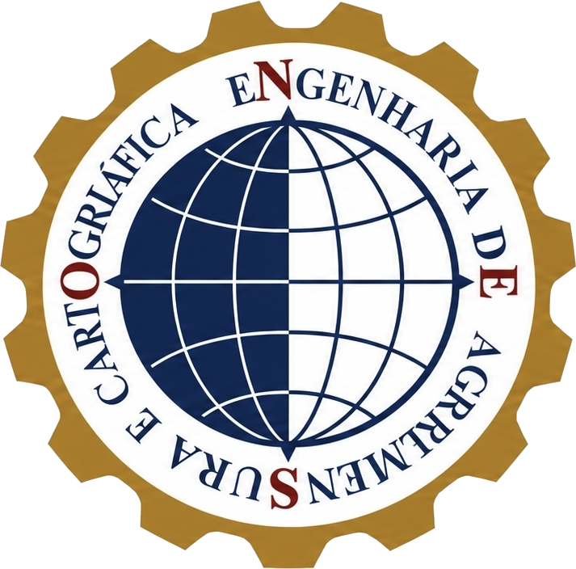
</p>

<h1 align="center">Acervo do LEA</h1>

<p align="center">
  <b>Laboratório de Engenharia de Agrimensura e Cartográfica | UFV</b><br>
  Os equipamentos do laboratório, a situação de cada unidade, as aulas práticas que os usam e o empréstimo com assinaturas, tudo pelo site.
</p>

<p align="center">
  <a href="https://darlanmnunes.github.io/lea-eam-ufv/"><b>Abrir o site</b></a> |
  <a href="https://darlanmnunes.github.io/lea-eam-ufv/acervo.html">Ver o acervo</a> |
  <a href="https://darlanmnunes.github.io/lea-eam-ufv/acervo.html#/aulas">Aulas do semestre</a> |
  <a href="https://github.com/darlanmnunes/lea-eam-ufv/releases">Versões</a>
</p>

<p align="center">
  <a href="https://github.com/darlanmnunes/lea-eam-ufv/releases/latest"></a>
  <a href="https://darlanmnunes.github.io/lea-eam-ufv/"></a>
  
</p>

<p align="center">
  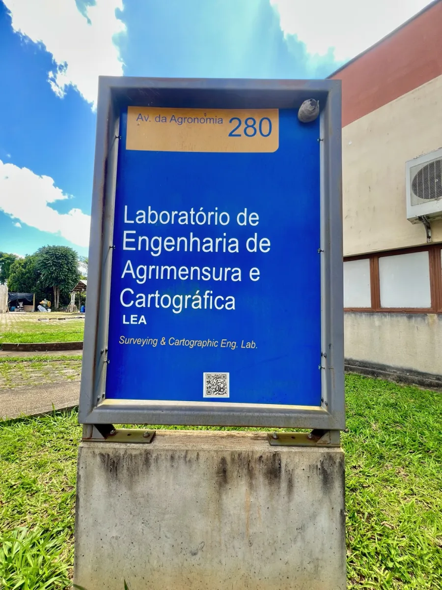
  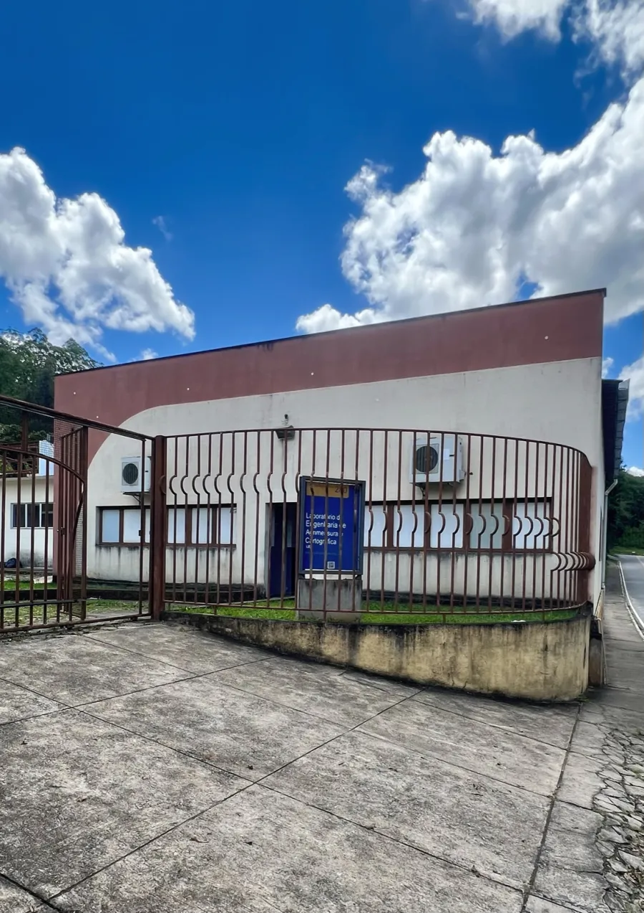
  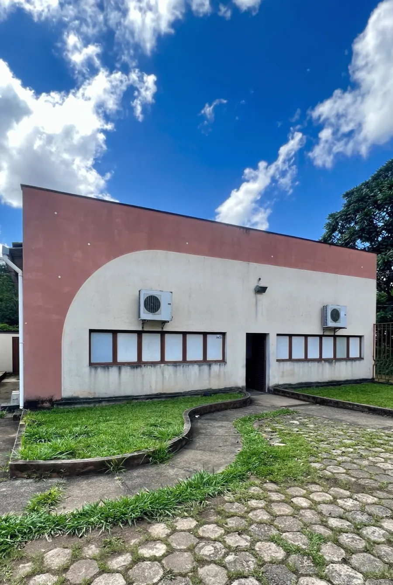
</p>

---

## Para que serve

Até aqui, pegar um equipamento do LEA emprestado exigia um requerimento em papel, com
assinaturas colhidas de sala em sala. O **Acervo do LEA** leva esse caminho para o site:

- **Consultar** o que o laboratório tem: estações totais, receptores GNSS, níveis, teodolitos,
  laser scanner, drones, planímetros e o apoio de campo, com o número de patrimônio e a foto quando houver.
- **Ver o que está livre** nas datas escolhidas, unidade por unidade.
- **Pedir e assinar** pelo site, com o termo de responsabilidade gerado ao final, pronto para
  imprimir ou salvar em PDF.
- **Respeitar as aulas práticas**: nos horários das disciplinas EAM que usam equipamento, as
  unidades reservadas saem da lista de empréstimo.

## Como funciona um empréstimo

São sete assinaturas, cada uma registrada com nome, data e hora. Ninguém precisa sair da sua sala.

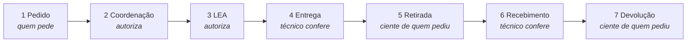

1. **Escolha datas e equipamentos.** O acervo mostra o que está livre no período. Você informa a
   atividade, o local e quem vai a campo.
2. **Receba as duas autorizações.** A coordenação da área e o responsável pelo LEA assinam pelo
   site, cada um na sua vez.
3. **Retire e devolva com ciente.** O técnico confere item por item e anota as ressalvas, e você
   confirma a retirada e a devolução. Cada etapa aceita observações.

## Telas

| Página inicial | Acervo |
| --- | --- |
| 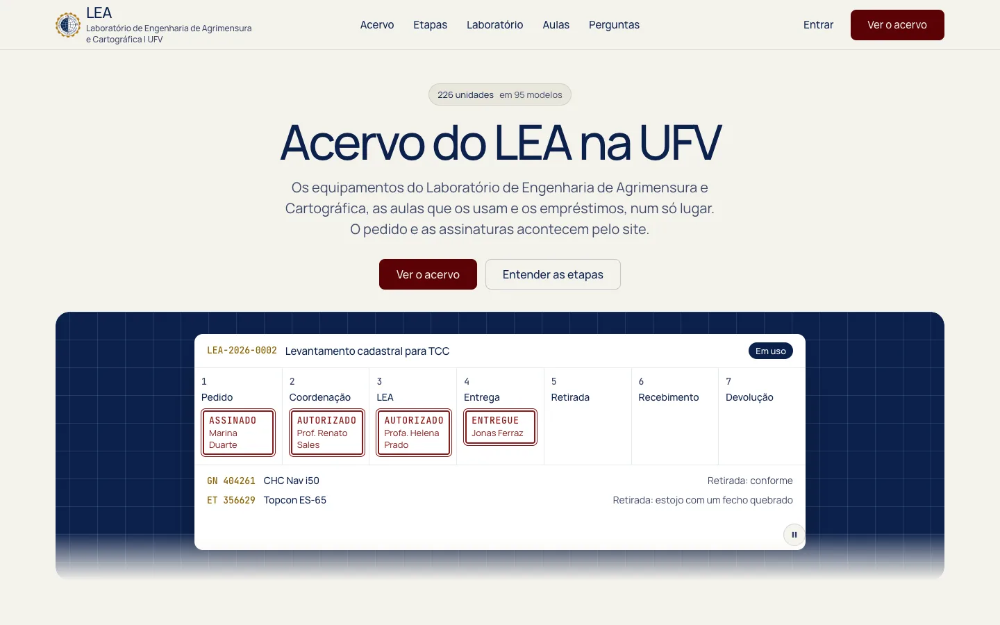 | 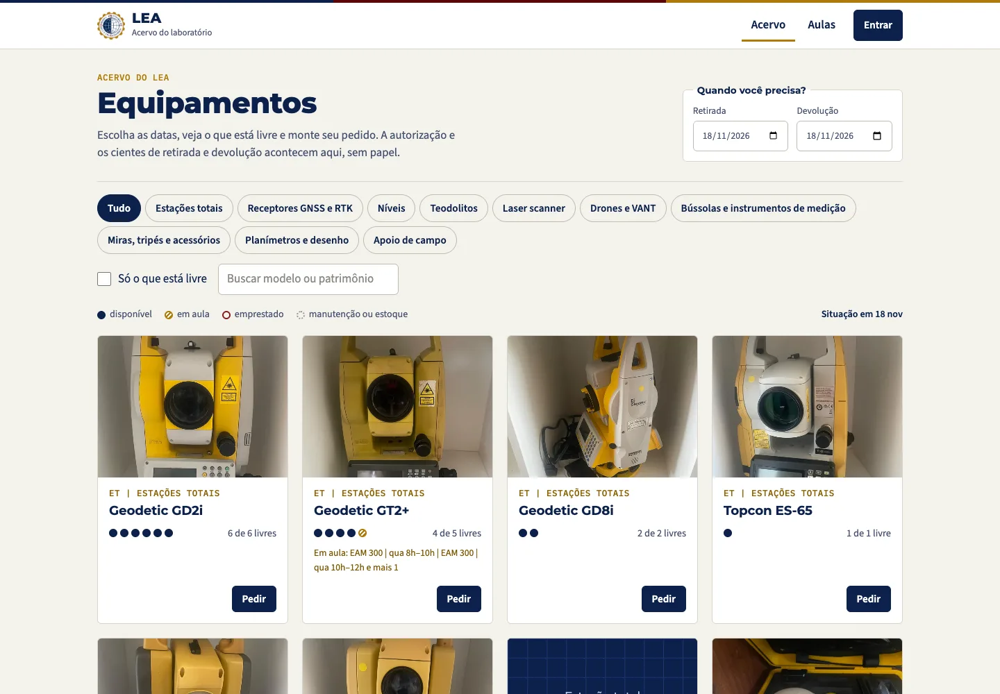 |
| **Equipamento** | **Aulas práticas** |
| 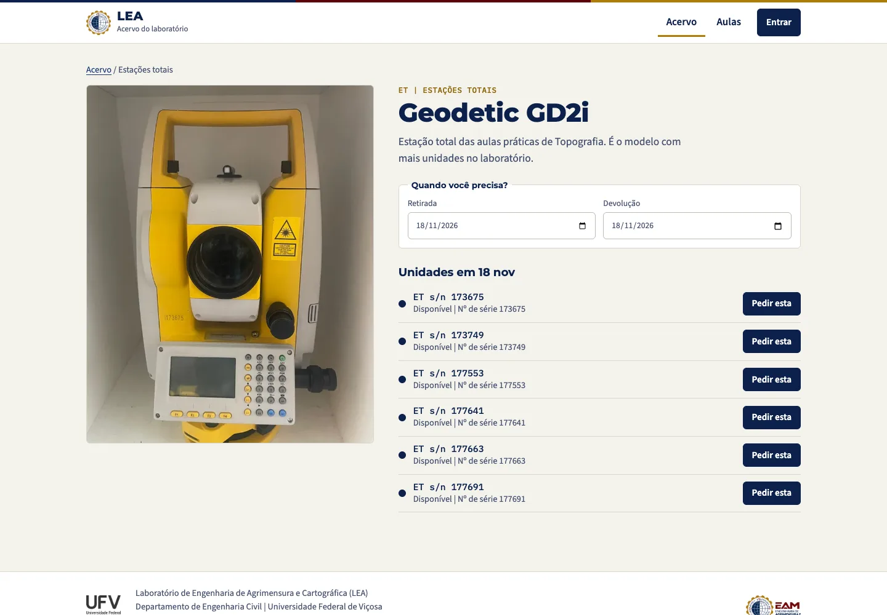 | 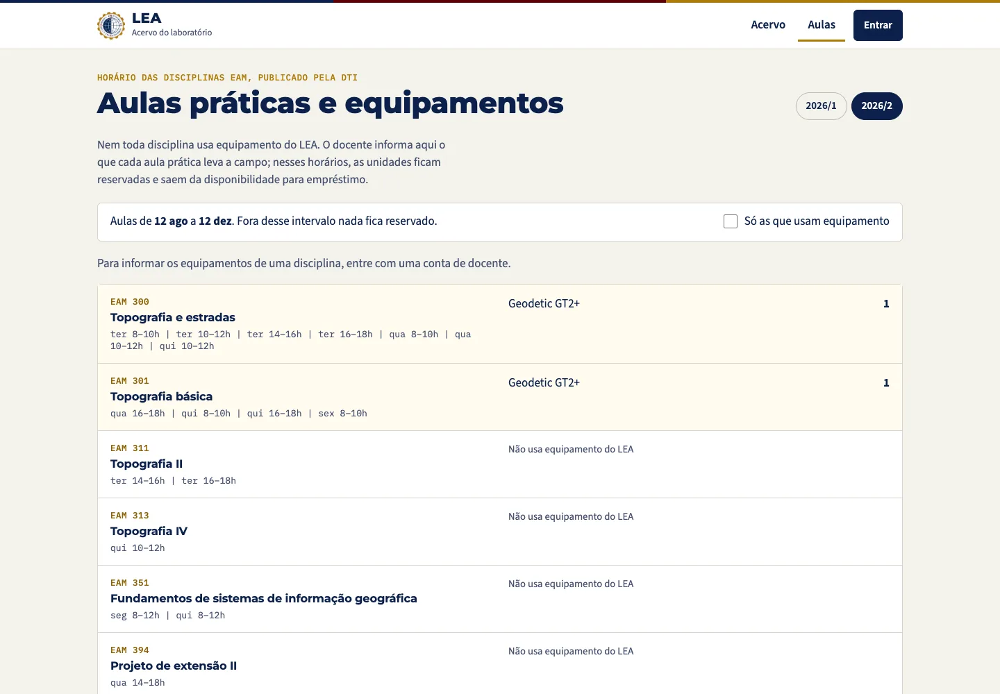 |

## Situação de cada unidade

| Marca | Situação | O que quer dizer |
| --- | --- | --- |
| ● | Disponível | Livre para pedir nas datas escolhidas |
| ◍ | Em aula | Reservada para uma aula prática EAM no período |
| ○ | Emprestada | Está com outra pessoa nessas datas |
| ◌ | Manutenção ou estoque | Fora de circulação até o técnico liberar |

## Quem faz o quê

O acesso é com a **conta Google da UFV** (@ufv.br). No primeiro acesso, a pessoa informa
matrícula e telefone, que entram no termo de responsabilidade.

| Papel | O que faz |
| --- | --- |
| Solicitante | Qualquer pessoa da UFV: pede e dá ciente de retirada e de devolução |
| Docente | Informa os equipamentos que cada disciplina leva às aulas práticas |
| Coordenação da área | Primeira autorização |
| Responsável pelo LEA | Segunda autorização e prorrogações |
| Técnico do LEA | Cadastra equipamentos, muda a situação das unidades, entrega e recebe |
| Administração | Define os papéis e as datas do semestre |

## Onde fica

O LEA fica na Avenida dos Lagos, no campus da UFV em Viçosa (MG). Os equipamentos ficam no
almoxarifado da sala 108, com atendimento das 7h às 12h e das 13h às 18h.

<p align="center">
  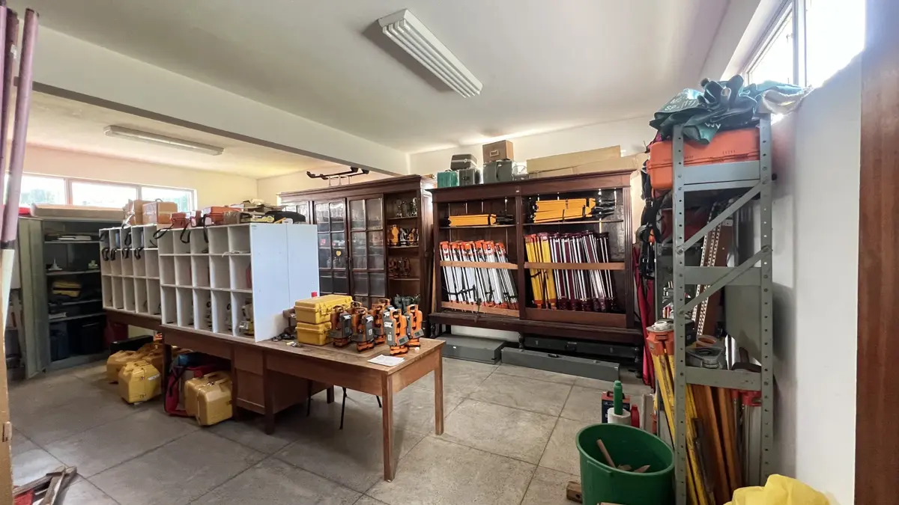
</p>

---

## Para quem mantém o sistema

<details>
<summary><b>Como o projeto está organizado</b></summary>

| Pasta | Conteúdo |
| --- | --- |
| `public/` | Página inicial, fotos do laboratório e dos equipamentos, marcas da UFV e da EAM |
| `src/` | Aplicação do acervo (React + TypeScript, Vite) |
| `src/dados/` | Acervo inicial e horário das aulas EAM |
| `db/` | Esquema PostgreSQL, regras do fluxo, dados iniciais e testes |
| `dados-fonte/` | Planilhas de origem do acervo, já sem dados pessoais |
| `scripts/` | Montagem do acervo, importação do horário da DTI e publicação |
| `supabase/functions/lembretes/` | Envio dos lembretes por e-mail |

Tecnologias: React 18, TypeScript, Vite, PostgreSQL no Supabase (região São Paulo) e GitHub Pages.
</details>

<details>
<summary><b>Rodar no computador</b></summary>

```bash
npm install
npm run dev
```

Sem o arquivo `.env`, o site abre em **modo demonstração**: os dados ficam só no navegador e há
seis pessoas fictícias, uma para cada papel, para percorrer o fluxo inteiro.
</details>

<details>
<summary><b>Disponibilidade e horário das aulas</b></summary>

Uma unidade está livre num período quando está em circulação, não tem outro pedido nas mesmas
datas e não está reservada para aula. A reserva vem do horário das disciplinas EAM publicado pela
DTI, cruzado com o que cada docente informou.

Para importar o horário de um novo semestre:

```bash
node scripts/importar-horarios.mjs 2027 1
```
</details>

<details>
<summary><b>Banco de dados</b></summary>

As regras ficam no próprio banco: quem pode assinar cada etapa, bloqueio de reserva em dobro,
prioridade das aulas e registro imutável das assinaturas.

```bash
npm run db:teste      # cria um banco descartável e percorre o fluxo inteiro
npm run db:local      # cria o banco "lea" para explorar
npm run db:supabase   # junta os scripts em db/supabase_completo.sql
```

Para montar um projeto novo no Supabase:

1. Rode `db/supabase_completo.sql` no SQL Editor.
2. Em Authentication, ative o provedor Google e inclua o endereço do site em URL Configuration.
3. Copie `.env.example` para `.env` com a URL e a chave pública do projeto.
4. Entre no site e torne-se administrador pelo SQL Editor:

   ```sql
   update pessoas set papeis = '{solicitante,admin}' where email = 'voce@ufv.br';
   ```

   Os demais papéis são definidos na tela **Pessoas**, e as datas do semestre na tela **Aulas**.
</details>

<details>
<summary><b>Lembretes por e-mail</b></summary>

A função `supabase/functions/lembretes` avisa quem precisa autorizar, entregar ou dar ciente e
repete o aviso a cada 24 horas até a etapa andar. Ela entra em funcionamento quando o envio pela
conta institucional do curso for liberado.
</details>

<details>
<summary><b>Publicar e levar ao site do curso</b></summary>

```bash
npm run publicar
```

O comando gera o site e envia a pasta `dist/` para o ramo `gh-pages`, de onde o GitHub Pages
publica. O site usa caminhos relativos, então funciona em qualquer endereço. Para o site do curso:

1. **Link ou botão** para `https://darlanmnunes.github.io/lea-eam-ufv/` (o mais simples).
2. **Copiar a pasta `dist/`** para o servidor do curso e incluir o novo endereço no Supabase.
3. **Embutir o catálogo** numa página existente:

   ```html
   <iframe src="https://darlanmnunes.github.io/lea-eam-ufv/acervo.html"
           title="Acervo do LEA" style="width:100%;height:900px;border:0"></iframe>
   ```

   Para pedir e assinar, use o link direto: dentro de um iframe o login abre fora dele.
</details>

---

<p align="center">
  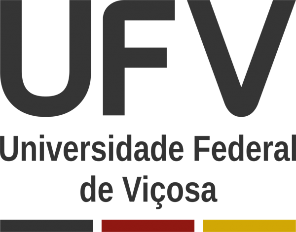&nbsp;&nbsp;&nbsp;
  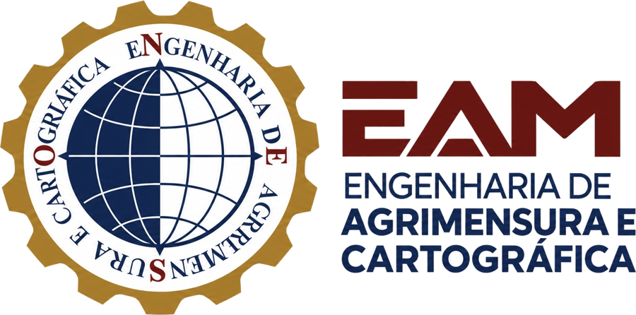
</p>

<p align="center">
  Engenharia de Agrimensura e Cartográfica | Departamento de Engenharia Civil | Universidade Federal de Viçosa<br>
  Desenvolvido por <b>Prof. Dr. Darlan Miranda Nunes</b>
</p>
